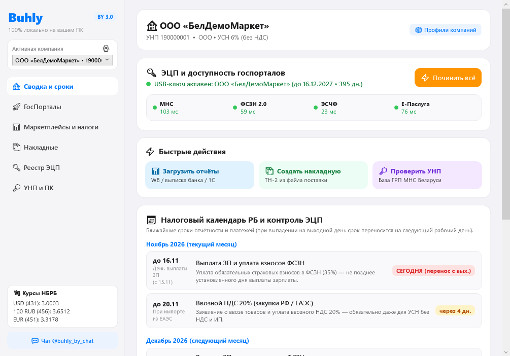

# Buhly v3.0 • Помощник селлера и малого бизнеса РБ

**Локальный помощник селлера и малого бизнеса РБ: WB/Ozon, налоги (УСН и ИП), ТН-2/БСО, выписка любого банка и госпорталы в 1 клик.**

Единый portable-файл (`~541 КБ`, без установки и без `.cmd`-скриптов) для Windows 10/11 (.NET Framework 4.8 / WPF). Лицензия: [MIT](LICENSE).



---

## Возможности Buhly v3.0

- **🏢 Мультипрофиль компаний и Налоговый календарь РБ:**
  - Переключение между несколькими ООО и ИП в боковой панели (`%LOCALAPPDATA%\Buhly\profiles.xml`), автозаполнение реквизитов со вставленного USB-токена ЭЦП и из базы ГРП МНС.
  - Актуальный налоговый календарь РБ на текущий и следующий месяц с автоматическим переносом сроков с выходных на рабочий день (выплата ЗП и ФСЗН 35% до 15-го, ввозной НДС 20% РФ/ЕАЭС до 20-го, квартальные сроки УСН / Подоходного налога / 4-Фонда / Белгосстраха) и контролем истекающих ключей ЭЦП.
  - Курсы НБРБ в боковой панели (`USD 431`, `100 RUB 456`, `EUR 451`).
- **📊 Маркетплейсы (WB + Ozon), все банки РБ, налоги и 1С:**
  - Загрузка детальных отчётов реализации **Wildberries** (`.zip` / `.xlsx`, включая компенсации и корректировки) и отчётов **Ozon** (`.xlsx`), авто-фильтрация дублей.
  - Универсальный парсер выписок всех банков РБ: стандартный формат `1CClientBankExchange` (`.txt` в Windows-1251 и UTF-8), а также гибкий парсер `.xlsx`/`.csv` (Беларусбанк, Приорбанк, МТБанк, Белинвестбанк, БНБ, Сбер, Альфа-Банк).
  - Расчёт налогов с привязкой к режиму из профиля: **ООО • УСН 6% (без НДС)**, **ИП • Подоходный налог 20% (или 30% > 500 000 BYN) + ФСЗН 35%** (сравнение «доходы минус расходы» и стандартного вычета 20%), **ООО • ОСН**.
  - Встроенный калькулятор **Ввозного НДС 20% (РФ/ЕАЭС)** с подгрузкой курса `100 RUB` НБРБ на выбранную дату.
  - Интерактивный `DataGrid` юнит-экономики по SKU, кнопка **«⚡ Попробовать на демо-данных»**, экспорт в **Excel-сводку**, **📒 КУДиР (Раздел I)** и **📤 выгрузку для 1С (XML / CSV)**.
- **📦 Накладные ТН-2 / ТТН-1, БСО и WB FBO:**
  - Поддержка поставок **WB FBS и WB FBO** с редактируемым предпросмотром, подстановкой цен из справочника и точной математикой НДС (`Цена с НДС` / `Цена без НДС`) с подсветкой копеечных округлений.
  - Переключатель **ТН-2** / **ТТН-1** (автомобиль, водитель, пункты погрузки/разгрузки) и 3 режима вывода: полный бланк А4, **печать чистых данных на типографский бланк БСО** (с отступами в мм) и **Приложение к накладной**.
  - Опциональный **Лист сборки** со стикерами и артикулами.
- **🚀 ГосПорталы РБ, Реестр ЭЦП и диагностика ПК:**
  - Вход в 1 клик: **МНС** (`nalog.gov.by`), **ФСЗН 2.0** (`portal2.ssf.gov.by`), **ЭСЧФ** (`vat.gov.by` — бессрочный IE Mode в Edge через политику без закрытия браузера), **Е-Паслуга** (`e-pasluga.by`).
  - Реестр всех ключей ЭЦП (`%LOCALAPPDATA%\Buhly\cert_registry.tsv`): обнаружение старых дублей при продлении сертификата, фильтр истекающих `≤30 дн.`, экспорт в CSV/Excel.
  - Проверка контрагента по УНП в базе ГРП МНС, диагностика порта 8084 (`NTClient`), откат `hosts` и прокси (`PAC`) из резервной копии.

---

## Для сисадминов и СБ

1. **Сборка из исходного кода за 3 секунды (0 сторонних DLL и NuGet):**
   ```bat
   git clone https://github.com/narard/buhly-rb.git
   cd buhly-rb
   build.bat
   ```
   `build.bat` компилирует проект штатным компилятором Windows `C:\Windows\Microsoft.NET\Framework64\v4.0.30319\csc.exe` из открытых файлов (`Program.cs`, `SystemDiagnoser.cs`, `GovServices.cs`, `CompanyProfiles.cs`, `OverviewTab.cs`, `PortalsTab.cs`, `RegistryTab.cs`, `ToolsTab.cs`, `WaybillEngine.cs`, `WaybillTab.cs`, `AnalyticsEngine.cs`, `AnalyticsTab.cs` + встроенные ресурсы `Template_TN2.xlsx` и `Template_TTN1.xlsx`) с манифестом `app.manifest` (`level="asInvoker"`, без автоповышения прав).

2. **Проверка целостности (SHA-256):**
   - Проверка локального файла в PowerShell:
     ```powershell
     Get-FileHash .\Buhly.exe -Algorithm SHA256
     ```
   - Актуальный SHA-256 `Buhly.exe` (v3.0.0.0):  
     `EAEC888200DC7555AE86ABF67D9F052E060527906E403C7AB9DEE4550C466F19`
   - См. также файл `Release/SHA256SUMS.txt` (генерируется автоматически в GitHub Actions `.github/workflows/release.yml`).

3. **Гигиена безопасности и предсказуемость:**
   - В релизах распространяется только чистый `Buhly.exe` / `Buhly.zip` (без `.cmd` и PowerShell-обёрток `ExecutionPolicy Bypass`).
   - Сетевые обращения идут только напрямую к официальным сервисам РБ (`nbrb.by`, `portal.nalog.gov.by`, `nalog.gov.by`, `ssf.gov.by`, `vat.gov.by`, `e-pasluga.by`) со строгой проверкой TLS 1.2 (`ServerCertificateValidationCallback` не отключается).
   - Приложение не имеет доступа к закрытым ключам ЭЦП, не запрашивает PIN-код, не вызывает `Process.Kill()` для `EDeclaration`/`MngCert` и делает `.bak`-резервные копии перед изменением `hosts`, `AutoConfigURL` и Edge `Preferences`.
   - Для корпоративного развёртывания и Microsoft Store подготовлен шаблон MSIX в папке `msix/` (`Package.appxmanifest` + `build_msix.ps1`).

---

## О разработчике и приватности

- **Политика «0% телеметрии»:** 100% данных — отчёты WB/Ozon, банковские выписки, накладные, справочники себестоимости, профили организаций и реестр ЭЦП — обрабатываются и хранятся исключительно локально на вашем ПК (`%LOCALAPPDATA%\Buhly\`). Программа не отправляет статистику, не содержит рекламы и не использует облачные серверы.
- **Проект и контакты:**
  - Проект: Buhly Open Source (независимая разработка, Республика Беларусь)
  - Лицензия: [MIT License](LICENSE)
  - Обратная связь: [Чат @buhly_by_chat](https://t.me/buhly_by_chat) • [Канал @buhly_by](https://t.me/buhly_by) • [GitHub Issues](https://github.com/narard/buhly-rb/issues)

---

## Сообщество

- Официальный сайт: [buhly.by](https://buhly.by)
- Telegram-канал (обновления и новости): [@buhly_by](https://t.me/buhly_by)
- Telegram-чат поддержки и бухгалтеров: [@buhly_by_chat](https://t.me/buhly_by_chat)
